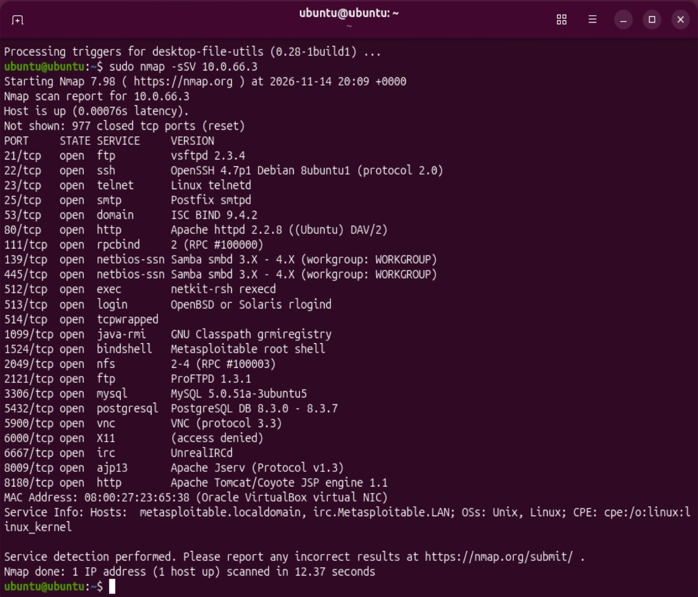
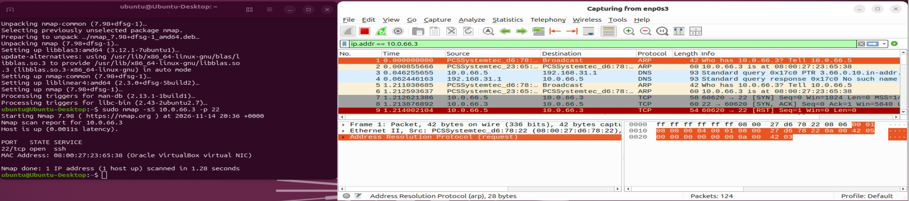
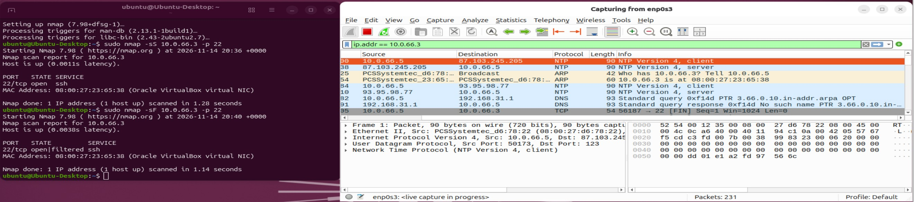
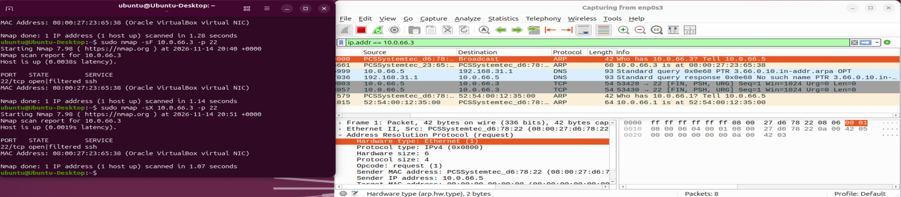
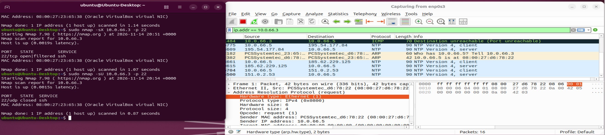

# Домашнее задание к занятию «Уязвимости и атаки на информационные системы». Соколов И. В. 

### Задание 1

Скачайте и установите виртуальную машину Metasploitable: https://sourceforge.net/projects/metasploitable/.

Это типовая ОС для экспериментов в области информационной безопасности, с которой следует начать при анализе уязвимостей.

Просканируйте эту виртуальную машину, используя **nmap**.

Попробуйте найти уязвимости, которым подвержена эта виртуальная машина.

Сами уязвимости можно поискать на сайте https://www.exploit-db.com/.

Для этого нужно в поиске ввести название сетевой службы, обнаруженной на атакуемой машине, и выбрать подходящие по версии уязвимости.

Ответьте на следующие вопросы:

- Какие сетевые службы в ней разрешены?
- Какие уязвимости были вами обнаружены? (список со ссылками: достаточно трёх уязвимостей)
  
*Приведите ответ в свободной форме.*  

### Решение 1

- Какие сетевые службы в ней разрешены?

- Какие уязвимости были вами обнаружены? (список со ссылками: достаточно трёх уязвимостей)
1. vsftpd 2.3.4 (https://www.exploit-db.com/exploits/17491)
2. ProFTPD 1.3.1(https://www.exploit-db.com/exploits/8037)
3. Samba 3.x (https://www.exploit-db.com/exploits/16320)

### Задание 2

Проведите сканирование Metasploitable в режимах SYN, FIN, Xmas, UDP.

Запишите сеансы сканирования в Wireshark.

Ответьте на следующие вопросы:

- Чем отличаются эти режимы сканирования с точки зрения сетевого трафика?
- Как отвечает сервер?

*Приведите ответ в свободной форме.*

### Решение 2

Выполним сканирование по 22 порту. 

1. SYN-сканирование (порт 22/tcp открыт):
   
Поскольку служба SSH запущена и слушает 22-й порт, сервер отвечает пакетом [SYN, ACK] (подтверждение готовности установить соединение).
Получив этот ответ, nmap сразу определяет состояние порта как open и обрывает соединение, отправляя пакет [RST] (вместо завершения рукопожатия пакетом ACK).

2. FIN- и Xmas-сканирование (порт 22/tcp открыт):
   
В Wireshark видно, что сервер никак не отвечает (ответные пакеты от 10.0.66.3 отсутствуют). Из-за отсутствия ответа и невозможности отличить открытый порт от отфильтрованного межсетевым экраном nmap присваивает порту статус open|filtered

3. UDP-сканирование (порт 22/udp закрыт):

Служба SSH работает только по протоколу TCP, поэтому порт 22/udp закрыт.
В ответ на UDP-пакет сервер отправляет служебное сообщение протокола ICMP типа 3, код 3 — Destination unreachable (Port unreachable) (на третьем скриншоте подсвечено зелёной строкой в Wireshark). Получив это сообщение, nmap однозначно определяет состояние порта как closed.

